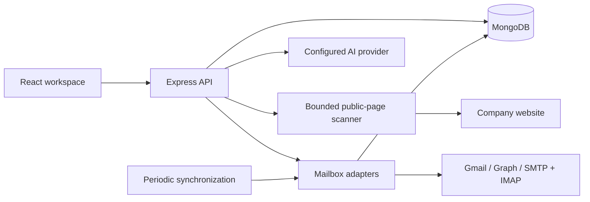

# ProspectDesk

[Live app](https://prospectdesk-shobhit9742.vercel.app) | [Video walkthrough](https://drive.google.com/file/d/1GLUehVtZc6rlMSMVO4eB4UZwo4uO2Zaa/view?usp=sharing)

A MERN application connecting company website research to individual mailbox conversations. Built as a standalone companion prototype for the Caprae assignment; it does not modify or integrate directly with SaaSquatch.

## Business purpose and design decisions

I chose to connect company research with outreach preparation because collecting information is only the first step. A user still needs to check the evidence, decide what is relevant to the conversation, and prepare a message. ProspectDesk keeps those steps together instead of requiring the user to copy information between a research tool and a separate email composer.

The main workflow is **scan a website → review the source evidence → enter an outreach objective → edit the context → choose an email variation → review the message in the connected mailbox composer**. The intended value is less repetitive copying and easier access to the research behind a message; time savings have not been measured.

- **Evidence before drafting:** company research retains original excerpts and source links so users can inspect what supports a point. Website statements remain distinct from verified claims.
- **Editable output:** context points and email variations can be reviewed and changed before sending. AI output is a starting point for a conversation, not an automatic decision about a lead.
- **Clear navigation:** Website Scanner, Connected Inboxes, and Unibox separate research, connection setup, and conversations while retaining a direct handoff from research to the composer.
- **Visible states:** generation mode, unreadable-page warnings, mailbox errors, and send outcomes help users understand what completed and what still needs attention.
- **Draft continuity:** saved drafts and mailbox-specific replies support returning to unfinished work. Provider acceptance is kept separate from confirmed recipient delivery.

## Features

- **Company Website Scanner:** up to three same-origin public HTML pages per scan, original excerpts and source links, explicit contact/location data, history, JSON export, one-hour per-user cache, manual refresh.
- **Outreach Context Generator:** up to three editable research points with evidence references, copy/download, and handoff to the email composer. An OpenAI-compatible provider produces objective-specific drafts when configured. Without an AI key, template mode ranks website excerpts by objective relevance and adds suggested discussion questions. The mode is shown before generation; template questions are not company facts or AI-generated analysis.
- **Email Variations:** Compose uses the selected company, outreach objective, and edited context to prepare three editable email options with subjects and message bodies. Users choose a variation and review it in the mailbox composer before sending.
- **Connected Inboxes:** Gmail OAuth, Microsoft OAuth, and SMTP/IMAP. SMTP requires port 465 or STARTTLS on 587; IMAP uses TLS on 993. SMTP connection verification sends no message.
- **Unibox:** account/folder filters, search, pagination, conversation history, compose, reply, application drafts, read/unread, archive/restore to Inbox, Junk, synchronization, and delivery-notification separation. Replies stay attached to the correct mailbox. Sends have persisted request keys and distinguish provider acceptance from confirmed recipient delivery.

### AI generation and template mode

With an AI provider configured, context generation uses selected website evidence and the outreach objective; email generation uses the company, objective, and edited context points to produce three introduction or collaboration drafts. These are three alternatives for the conversation, not necessarily one email per context point. Review factual support and the wording before sending.

Without `AI_API_KEY`, the app provides evidence-based context templates and three context-based email templates. The email templates use fixed collaboration structures rather than AI personalization. Both workflows identify template mode so users can distinguish it from provider-generated output. Mailbox messages and credentials are not inputs to these generation requests.

## Data and dataset

There is no bundled fixed dataset. The application collects research on demand from up to three public HTML pages on the entered company's website and stores the scan, source excerpts, and saved context in MongoDB under the user's workspace. A scan can be exported as JSON; context points can be downloaded as text.

To reproduce the research workflow, enter a publicly accessible company website in Website Scanner, review the source links and any page warnings, and export the resulting scan. Results can change when the source website changes. Private mailbox data, credentials, and the application's runtime database are not included in the repository.

## Local setup

Requires Node.js 24+, npm, and MongoDB. No production OutreachAI secrets are required or copied.

```powershell
npm ci
node scripts/setup-env.mjs
powershell -ExecutionPolicy Bypass -File scripts/start-mongo.ps1
```

Keep MongoDB running; in a second terminal:

```powershell
npm run dev
```

Open **http://127.0.0.1:5176** and create a workspace. API: http://127.0.0.1:4120. Use the same hostname consistently; localhost and 127.0.0.1 have different session cookies and OAuth callback URLs.

`server/.env` is excluded from Git. Setup generates independent session and AES-256-GCM credential-encryption keys. Preserve the encryption key when restarting or moving a database; replacing it makes existing mailbox tokens unreadable.

## Provider setup

### Gmail

Create a Google Cloud OAuth web application, enable Gmail API, and configure the consent screen/test users. Set `GOOGLE_CLIENT_ID` and `GOOGLE_CLIENT_SECRET`. Register the exact development callback:

```text
http://127.0.0.1:4120/api/oauth/google/callback
```

Scopes: `openid email https://www.googleapis.com/auth/gmail.modify`. Offline access is requested for background synchronization. Public distribution may require Google's OAuth verification; the local prototype does not claim to have completed it. [Gmail authorization](https://developers.google.com/workspace/gmail/api/auth/scopes).

### Microsoft

Register an application supporting your intended account types. Set `MICROSOFT_CLIENT_ID`, `MICROSOFT_CLIENT_SECRET`, and optional `MICROSOFT_TENANT`. Register:

```text
http://127.0.0.1:4120/api/oauth/microsoft/callback
```

Delegated scopes: `offline_access User.Read Mail.ReadWrite Mail.Send`. Reading permission alone does not prove send access. [Microsoft delegated permissions](https://learn.microsoft.com/en-us/graph/permissions-reference).

### SMTP/IMAP

Open Connected Inboxes and enter the mailbox email, authentication username/app password, and server hostnames. The app verifies both protocols before saving the encrypted connection. Only public mail servers and verified TLS certificates are supported. Providers may require an app password or disable basic authentication; use OAuth where appropriate. No real mailbox was connected automatically during development.

### AI

Set `AI_API_KEY`, `AI_MODEL`, and optionally `AI_BASE_URL` for an OpenAI-compatible chat-completions endpoint. Context generation sends selected website excerpts and the entered objective to that configured provider. It does not send mailbox messages or credentials. Returned evidence IDs are validated, but human review of factual support remains required.

## Architecture

React 19 + TypeScript + Vite; React Router, TanStack Query, Lucide, Sonner, self-hosted DM Sans, and a small custom CSS component system. Express 5 + TypeScript; MongoDB/Mongoose; Cheerio, Nodemailer, ImapFlow, Mailparser, Zod. The current UI uses custom components rather than claiming an installed shadcn/Tailwind implementation.



Collections: users, scans, accounts, messages, drafts, sendattempts, sessions. All protected reads and writes are user-scoped. Mailbox credentials use AES-256-GCM and are excluded from API responses. Sessions use HttpOnly cookies and MongoDB storage; production cookies require HTTPS. Mutation requests require a custom header and allowed origin. Mail bodies render as text, preventing remote image tracking and HTML execution.

Scanner requests validate every redirect, reject private/reserved IPs, pin DNS answers for the connection, cap pages at 2 MB, and time out after 12 seconds each. It does not bypass CAPTCHAs or automate authenticated websites. JavaScript-only sites may return limited evidence; that is reported honestly. Headings are labeled website statements, not inferred services or verified claims.

Synchronization runs manually and every two minutes for healthy connected accounts. The initial implementation reads bounded recent history: Gmail up to 50 recent messages; Microsoft up to 30 per Inbox/Sent/Archive/Junk; IMAP up to 50 per supported folder. It is not a full historical migration or incremental/delta synchronization engine. Cached older messages can remain when changed outside that synchronization window. Account errors remain visible and can be retried manually.

The in-process worker and locks are intended for one API instance. For multiple instances, move synchronization to leased durable jobs before scaling. Individual sends persist an idempotency key before submitting. Uncertain sends are not retried automatically. SMTP acceptance and Sent-folder persistence are separate outcomes.

## Production build

```powershell
npm run build
npm audit
```

## Hosting and deployment

### Vercel

`vercel.json` deploys the frontend and API together using `Dockerfile.vercel` and Vercel's container runtime. Set `MONGODB_URI`, `SESSION_SECRET`, `CREDENTIAL_KEY`, `APP_URL`, `API_URL`, and `PORT=4120` in the project's environment settings. Use the HTTPS application origin for both URL variables. Provider credentials remain optional; configure them and their callback URLs to enable the corresponding integrations.

On Hobby, mailbox synchronization is manual using the existing Synchronize actions. `Dockerfile.vercel` sets `SYNC_MODE=manual`; the standard local and Docker entry point retains its periodic synchronization worker when that setting is absent.

Locally the Vite development server proxies `/api` to Express. A production build is served by the same persistent Node service as the API; this is a container/server deployment rather than static-only or serverless hosting. MongoDB must retain its data volume.

The included standard Dockerfile/Compose definition packages that topology for persistent container hosts. Before using it behind an HTTPS reverse proxy, set `APP_URL` and `API_URL` to the actual public origin, update OAuth callbacks, and retain the environment secrets. MongoDB must run separately from Vercel; the Vercel Marketplace integration provisions MongoDB Atlas and supplies its connection through `MONGODB_URI`.

### Deployment steps

1. Import this GitHub repository into a Vercel project with the repository root as the project directory. The included `vercel.json` selects the `app` container service and `Dockerfile.vercel` builds the React frontend and Express API together.
2. Provision a persistent MongoDB database, such as MongoDB Atlas through the Vercel Marketplace, and configure its connection as `MONGODB_URI`.
3. Generate independent secrets using `node scripts/setup-env.mjs`. Copy the generated `SESSION_SECRET` and `CREDENTIAL_KEY` into the Vercel project's environment settings; keep the credential key stable for an existing database.
4. Set `APP_URL` and `API_URL` to the project's HTTPS application origin and set `PORT=4120`. Add AI and OAuth provider settings only for integrations you intend to enable. Production OAuth callbacks use that API origin with `/api/oauth/google/callback` or `/api/oauth/microsoft/callback`.
5. Deploy the project. The Docker build runs `npm ci` and `npm run build`; the runtime serves the built frontend and API from the Express service. Redeploy after changing environment variables so the running service receives the updated settings.
6. Open the deployed application, create a workspace, and run a public website scan. Review the evidence, generate context and email variations, and confirm which generation mode is displayed. If a mailbox is configured, use manual synchronization on the Vercel deployment and review the connection status in Connected Inboxes.

Vercel hosts the application container; MongoDB Atlas is the managed database option described here. The MongoDB connection determines the database provider and region. This repository does not establish the underlying cloud or region of a particular Atlas deployment.

## Source packaging

Context edits can be saved to research history. Closing the composer saves nonempty text as a draft; draft deletion is available in Unibox. Each send saves its draft first, and previous submission statuses prevent an uncertain draft from being accidentally resent after reopening.

Create a credential-free source archive with `powershell -ExecutionPolicy Bypass -File scripts/package-source.ps1`. Archives are written to `output/`, which is excluded from Git and Docker builds.
