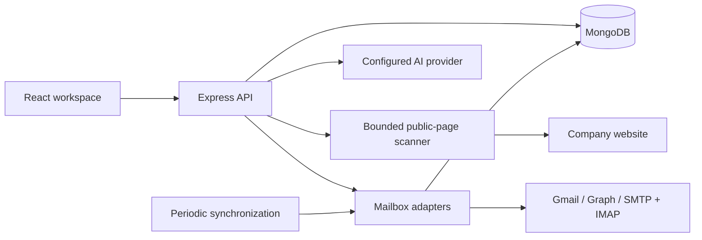

# ProspectDesk

A MERN application connecting company website research to individual mailbox conversations. Built as a standalone companion prototype for the Caprae assignment; it does not modify or integrate directly with SaaSquatch.

## Features

- **Company Website Scanner:** up to three same-origin public HTML pages per scan, original excerpts and source links, explicit contact/location data, history, JSON export, one-hour per-user cache, manual refresh.
- **Outreach Context Generator:** up to three editable research points with evidence references, copy/download, and handoff to the email composer. An OpenAI-compatible provider produces objective-specific drafts when configured. Without an AI key, template mode ranks website excerpts by objective relevance and adds suggested discussion questions. The mode is shown before generation; template questions are not company facts or AI-generated analysis.
- **Connected Inboxes:** Gmail OAuth, Microsoft OAuth, and SMTP/IMAP. SMTP requires port 465 or STARTTLS on 587; IMAP uses TLS on 993. SMTP connection verification sends no message.
- **Unibox:** account/folder filters, search, pagination, conversation history, compose, reply, application drafts, read/unread, archive/restore to Inbox, Junk, synchronization, and delivery-notification separation. Replies stay attached to the correct mailbox. Sends have persisted request keys and distinguish provider acceptance from confirmed recipient delivery.

## Local setup

Requires Node.js 24+, npm, and MongoDB. No production OutreachAI secrets are required or copied.

```powershell
npm ci
node scripts/setup-env.mjs
powershell -ExecutionPolicy Bypass -File scripts/start-mongo.ps1
```

Keep MongoDB running; in a second terminal:

```powershell
npm run dev
```

Open **http://127.0.0.1:5176** and create a workspace. API: http://127.0.0.1:4120. Use the same hostname consistently; localhost and 127.0.0.1 have different session cookies and OAuth callback URLs.

`server/.env` is excluded from Git. Setup generates independent session and AES-256-GCM credential-encryption keys. Preserve the encryption key when restarting or moving a database; replacing it makes existing mailbox tokens unreadable.

## Provider setup

### Gmail

Create a Google Cloud OAuth web application, enable Gmail API, and configure the consent screen/test users. Set `GOOGLE_CLIENT_ID` and `GOOGLE_CLIENT_SECRET`. Register the exact development callback:

```text
http://127.0.0.1:4120/api/oauth/google/callback
```

Scopes: `openid email https://www.googleapis.com/auth/gmail.modify`. Offline access is requested for background synchronization. Public distribution may require Google's OAuth verification; the local prototype does not claim to have completed it. [Gmail authorization](https://developers.google.com/workspace/gmail/api/auth/scopes).

### Microsoft

Register an application supporting your intended account types. Set `MICROSOFT_CLIENT_ID`, `MICROSOFT_CLIENT_SECRET`, and optional `MICROSOFT_TENANT`. Register:

```text
http://127.0.0.1:4120/api/oauth/microsoft/callback
```

Delegated scopes: `offline_access User.Read Mail.ReadWrite Mail.Send`. Reading permission alone does not prove send access. [Microsoft delegated permissions](https://learn.microsoft.com/en-us/graph/permissions-reference).

### SMTP/IMAP

Open Connected Inboxes and enter the mailbox email, authentication username/app password, and server hostnames. The app verifies both protocols before saving the encrypted connection. Only public mail servers and verified TLS certificates are supported. Providers may require an app password or disable basic authentication; use OAuth where appropriate. No real mailbox was connected automatically during development.

### AI

Set `AI_API_KEY`, `AI_MODEL`, and optionally `AI_BASE_URL` for an OpenAI-compatible chat-completions endpoint. Context generation sends selected website excerpts and the entered objective to that configured provider. It does not send mailbox messages or credentials. Returned evidence IDs are validated, but human review of factual support remains required.

## Architecture

React 19 + TypeScript + Vite; React Router, TanStack Query, Lucide, Sonner, self-hosted DM Sans, and a small custom CSS component system. Express 5 + TypeScript; MongoDB/Mongoose; Cheerio, Nodemailer, ImapFlow, Mailparser, Zod. The current UI uses custom components rather than claiming an installed shadcn/Tailwind implementation.



Collections: users, scans, accounts, messages, drafts, sendattempts, sessions. All protected reads and writes are user-scoped. Mailbox credentials use AES-256-GCM and are excluded from API responses. Sessions use HttpOnly cookies and MongoDB storage; production cookies require HTTPS. Mutation requests require a custom header and allowed origin. Mail bodies render as text, preventing remote image tracking and HTML execution.

Scanner requests validate every redirect, reject private/reserved IPs, pin DNS answers for the connection, cap pages at 2 MB, and time out after 12 seconds each. It does not bypass CAPTCHAs or automate authenticated websites. JavaScript-only sites may return limited evidence; that is reported honestly. Headings are labeled website statements, not inferred services or verified claims.

Synchronization runs manually and every two minutes for healthy connected accounts. The initial implementation reads bounded recent history: Gmail up to 50 recent messages; Microsoft up to 30 per Inbox/Sent/Archive/Junk; IMAP up to 50 per supported folder. It is not a full historical migration or incremental/delta synchronization engine. Cached older messages can remain when changed outside that synchronization window. Account errors remain visible and can be retried manually.

The in-process worker and locks are intended for one API instance. For multiple instances, move synchronization to leased durable jobs before scaling. Individual sends persist an idempotency key before submitting. Uncertain sends are not retried automatically. SMTP acceptance and Sent-folder persistence are separate outcomes.

## Validation

```powershell
npm run build
npm audit
```

Test files and test configuration are temporarily stored outside this checkout. Restore `client/tests`, `server/tests`, and `client/vitest.config.ts` before running `npm test`. Server tests require local MongoDB on port 27019 and use a uniquely named disposable `prospectdesk_test_*` database. Provider submissions are mocked; passing tests does not establish live mailbox delivery.

## Hosting and deployment

Locally the Vite development server proxies `/api` to Express. A production build is served by the same persistent Node service as the API; this is a container/server deployment rather than static-only or serverless hosting. MongoDB must retain its data volume.

The included Dockerfile/Compose definition packages that topology. Before using it behind an HTTPS reverse proxy, set `APP_URL` and `API_URL` to the actual public origin, update OAuth callbacks, and retain the environment secrets. Use a persistent container host such as AWS ECS/EC2 and MongoDB Atlas, or a managed container service with a separate persistent MongoDB. No cloud provider has been configured or deployment performed. The Docker definition requires a Docker runtime and is not presented as a verified cloud release.

## Source packaging

Context edits can be saved to research history. Closing the composer saves nonempty text as a draft; draft deletion is available in Unibox. Each send saves its draft first, and previous submission statuses prevent an uncertain draft from being accidentally resent after reopening.

Create a credential-free source archive with `powershell -ExecutionPolicy Bypass -File scripts/package-source.ps1`. Archives are written to `output/`, which is excluded from Git and Docker builds.
